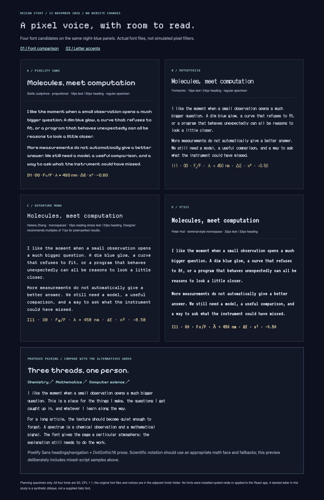
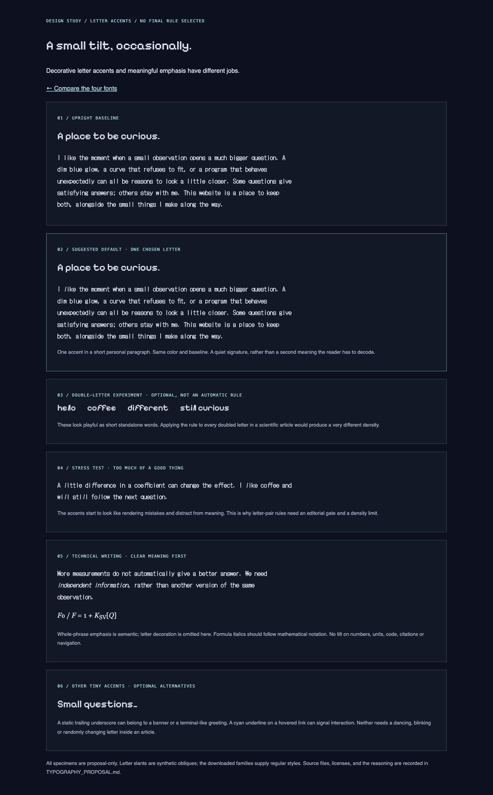

# Typography proposal: a pixel voice with room to read

12 November 2026 · **Planning only. No production TSX, CSS, font configuration, or content has been changed in this round.** The HTML specimens below are isolated design documents, not website routes. Fonts are stored only beside the documents, not installed on the computer or bundled into the app.

## My recommendation

Try **Pixelify Sans for headings and short navigation text, paired with DotGothic16 for prose**. The former gives the page a warm, playful pixel identity; the latter is the lighter reading face. Retain appropriate conventional fonts for equations, code, dense data and missing glyphs. This is a proposal to test on real articles, not a final font selection.

After viewing the actual font files on the site's blue-gray background, I prefer this combination to using a chunky terminal font everywhere. Pixelify's rounded shapes work with the illustrated banners, but a full article in it feels heavier. DotGothic16 is closer to the quiet, early-desktop texture that makes the reference site appealing. These are visual judgments, not reader-study results. A long chemistry or mathematics article at phone size is the next important test before adoption.

The live, standalone specimen is [preview.html](preview.html). It includes the same prose in all four faces, a mixed-symbol line, and a proposed combined panel. The screenshots preserve the rendering even without starting a local preview server.

## What I observed at dimden.dev

On the [homepage](https://dimden.dev/), the inspected main panel declares `RussianGothic, "MS UI Gothic", NEC_APC3, Tahoma` at 16px. That is a declared fallback stack; it does not establish that all visitors render the same font. The text has a much lighter texture than a heavy arcade display face.

The page source explicitly places individual letters in italic elements: a letter inside “little,” the initial “p” of “programmer,” the “l” in “love,” and several other letters. The examples are not all doubled letters or all emotional words. **My inference is that the effect is editorial and hand-placed**, rather than evidence for one universal spelling rule. We can adopt that deliberate, slightly irregular feeling while making our own choices. None of dimden's font files, markup or styles are copied into these specimens.

## Shortlist and roles

| Font | Suggested use | What I like here | Main reservation |
| --- | --- | --- | --- |
| **[Pixelify Sans](https://github.com/google/fonts/tree/main/ofl/pixelifysans)** — Stefie Justprince | First choice for banners, page headings, section titles and short navigation | Rounded pixel shapes; expressive without feeling like a game HUD; variable weights 400–700 | A whole article feels visually heavy; reserve heavier weights for short titles |
| **[DotGothic16](https://github.com/google/fonts/tree/main/ofl/dotgothic16)** — Fontworks / project authors | First pixel-prose candidate, short descriptions, notebook writing | Light desktop-era texture; closest reading mood among these candidates | Airy spacing and thin strokes need checking on different displays; the supplied face is regular |
| **[Departure Mono](https://departuremono.com/)** — Helena Zhang | Strong alternate for headings and small interface labels | Carefully drawn, technical pixel character; especially attractive at 22px headings and 11px labels | Monospacing makes paragraphs spread out; the [designer recommends multiples of 11px](https://github.com/rektdeckard/departure-mono#usage) for pixel-perfect rendering, which makes 16px prose a compromise |
| **[VT323](https://github.com/google/fonts/tree/main/ofl/vt323)** — Peter Hull | Optional terminal-like greetings or playground specimens | Strong old-terminal atmosphere; compact and recognizably retro | Too much terminal texture for the general article body; I would not add it as a third permanent site font |

The specimen uses different text sizes to compensate for the faces' different apparent sizes, and labels those sizes explicitly. Departure's 16px paragraph is a reading stress test, not a claim that it lands on its intended pixel grid. The symbol row deliberately exposes mixed-script/fallback issues; it is not a guarantee that a family covers every scientific character.

All four downloaded families are **SIL Open Font License 1.1**, with the notices retained in [fonts/](fonts/). Pixelify's [metadata](https://raw.githubusercontent.com/google/fonts/main/ofl/pixelifysans/METADATA.pb), DotGothic16's [metadata](https://raw.githubusercontent.com/google/fonts/main/ofl/dotgothic16/METADATA.pb), VT323's [metadata](https://raw.githubusercontent.com/google/fonts/main/ofl/vt323/METADATA.pb), and Departure's [font license](https://github.com/rektdeckard/departure-mono/blob/main/public/assets/LICENSE) document the sources. The downloaded specimens supply regular styles; **the letter slants in this study are synthetic obliques, not authentic italic cuts**. We should not silently describe those as designed italics.

## Starting size and spacing proposal

- Banner: Pixelify Sans, about 30–36px on desktop and 26–30px on phones, 400 or 500 weight.
- Page title: Pixelify Sans, 28–32px. Section headings: 22–24px. Allow wrapping; never squeeze a long project title to force one line.
- Main prose: DotGothic16, 16px, roughly 28–30px line height. Try 17–18px only after checking actual rendering; larger is not automatically sharper for a pixel-inspired face.
- Article measure: approximately 60–70 characters where space permits. No forced letter spacing in prose. No all-caps paragraphs.
- Navigation: try Pixelify Sans at 16–18px, subject to the existing narrow sidebar. Tiny metadata, date strings, units, axis labels and mood readouts should prioritize clarity over the pixel treatment; retaining the existing conventional mono face is a good starting point.
- Code: a real programming monospace. Equations: an appropriate math face. Mathematical italics remain notation, not decoration. Check minus signs, subscripts, Greek letters and distinguishing `I/l/1` and `O/0` explicitly.

Use at most **two permanent personality fonts**. The cleaner alternate is Departure Mono headings + the current system body font. If DotGothic16 becomes tiring in a long phone article, keep it in personal introductions and notebook entries and retain the conventional face for the technical body. That would be an intentional reading hierarchy, not a failed font choice.

## Two different meanings of a tilted letter

**Meaningful emphasis:** italicize a whole word or short phrase when the author actually changes emphasis. For example, “We need *independent information*, rather than another version of the same observation.” This should remain understandable in plain text and use semantic emphasis if implemented later.

**Decorative accent:** a single slightly slanted letter gives a personal voice without adding a new claim. It should retain normal spelling, spacing, color, baseline and copy/paste behavior. It should not be announced to assistive technology as a separate word, and should not replace meaningful emphasis.

See [letter-study.html](letter-study.html) for an upright baseline, a restrained example, doubled-letter experiments, an intentionally excessive sample and technical prose.

## Suggested decorative policy — not finalized

### 1. Choose the writing zone before choosing letters

- **Home introduction, About, casual notebook:** eligible. A little visible personality belongs here.
- **Personal opening or closing of a project:** occasionally eligible, perhaps one accent in the entire introduction.
- **Technical article body, explanations, formulas, citations, tables, code, figure labels, navigation, numbers and units:** no decorative letter slants by default. Ordinary, meaningful emphasis is still available.

### 2. Prefer personal meaning over spelling

For a first trial, hand-pick an initial letter in a genuinely personal expression: **l**ove, **l**ike, **h**ate, or a word of curiosity such as **w**onder. These are candidate words, not a mandatory find-and-replace list. Only use the emotional sense: “I like…” is eligible; “looks like…,” “likelihood,” and “unlike” are not triggers. There is no need to introduce negative language just to use the “hate” treatment.

Mark only the first chosen occurrence in a local passage. Do not decorate every matching word across the page. I would initially allow **one letter in a 50–100-word personal paragraph, and no more than about three across the homepage's main copy**. Short widget labels and factual readouts stay upright. These numbers are proposed ceilings, not quotas.

### 3. Keep doubled letters as an optional second experiment

Your `ll` / `ff` idea is worth trying in an informal greeting, heading or short aside: he*l*lo, co*f*fee, sti*l*l curious. The live specimen slants only the first letter of the pair. It is **not an accepted global rule**.

In scientific prose, words such as “different,” “effect,” and “coefficient” occur frequently. A site-wide spelling rule would decorate technical vocabulary almost at random and could disturb `ff` ligatures or close letter spacing. If we adopt the idea, make it an editorial opt-in for a particular word, with the same density ceiling. When both an emotional word and a doubled-letter candidate qualify, choose one; do not stack the effects.

### 4. A tilt is enough

Start with a restrained oblique around 8–10 degrees, tested separately in each chosen face. No extra spacing, bouncing, random rotations, blur, chromatic splitting or continuous animation in prose. Keep the same text color initially. The screenshots use a 10-degree synthetic slant to make the proposal inspectable; actual implementation would need to check collisions and line wrapping.

A static underscore in an existing banner can remain part of that banner's voice. A cyan underline on a hovered/focused link can communicate interaction. Unlinked words should not acquire link-like hover behavior. Do not combine a letter tilt, glow, color change and movement on the same word.

### 5. Make it authored and stable

Select the word while editing the passage. Its appearance should not change on reload, because of the weather, or while someone is reading. The same paragraph should receive the same accents wherever it is reused. Never split a URL, personal name, chemical formula or code identifier just to make the pattern fit.

## What I would trial first

1. The proposed two-font pairing on a private copy of Home, one long chemistry snippet and one math topic, plus a phone view. Compare with the current system-font article body.
2. One slanted initial in the homepage's personal opening. Leave the technical body alone.
3. A single optional doubled-letter word in a notebook greeting, shown alongside an upright version.
4. Check reading comfort, selections, keyboard focus, wrapped titles, chemical/mathematical glyphs, fallback behavior, 200% zoom and reduced motion. Check actual paragraph density rather than judging only a beautiful heading.

If we implement later, self-host the selected, optimized font files and retain their notices and creator credits. The full specimen downloads here are for evaluation, not a production loading plan. No public routes, TSX components, production styles, dependencies, system fonts or site credits were changed for this proposal.

## Preview checks and files

The isolated specimens were visually reviewed on desktop and at a 390px phone width. The phone specimen has no horizontal page overflow; [pairing-phone.png](pairing-phone.png) records the proposed pairing at that width. This does not replace a future reading test on an actual long article. Browser tabs and the temporary specimen server were closed after review.

- `preview.html`: four actual-font specimens and the proposed pairing.
- `letter-study.html`: upright, restrained, doubled-letter and dense accent comparisons.
- `font-comparison.png`, `font-shortlist.png`, `letter-accents.png`, `pairing-phone.png`: rendered previews.
- `fonts/SOURCES.json`: download sources, retrieval date and hashes. Font files and unmodified OFL notices sit alongside it.
